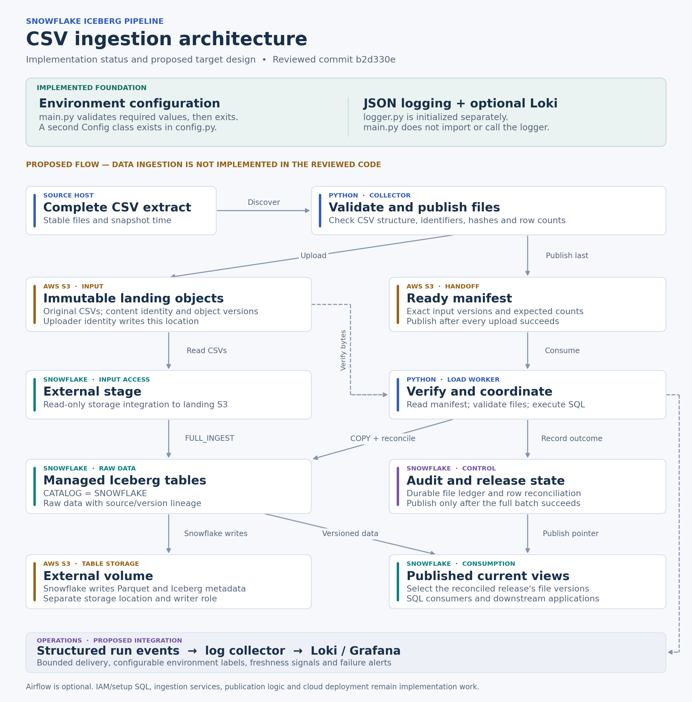
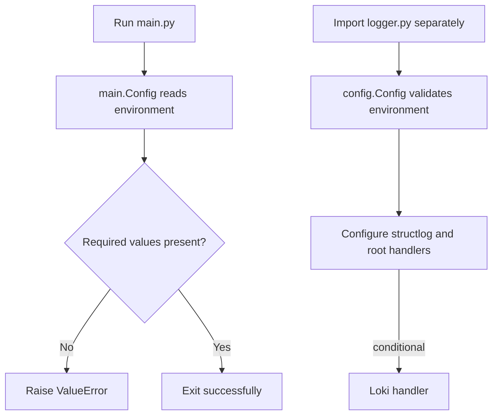
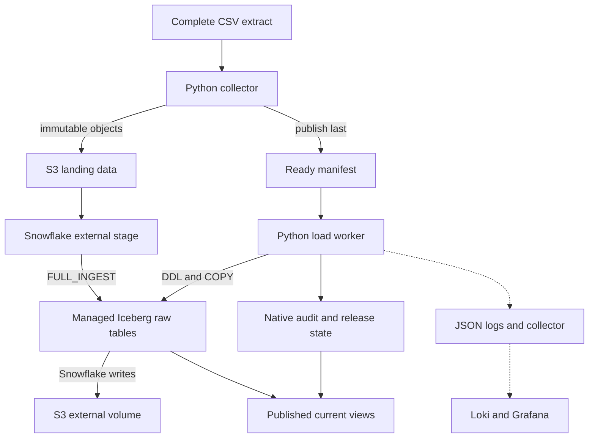

# Architecture: current foundation and proposed ingestion system

## Scope and status

The reviewed repository contains two configuration definitions and one logging module. It does not yet contain a data pipeline. The implementation-status band in the diagram describes existing code; the main data-flow diagram describes the proposed completion.

The editable diagram is [architecture.mmd](architecture.mmd); [architecture.svg](architecture.svg) is a vector export.

## What executes today

There is no call from main.py to logger.py, and no call to an AWS or Snowflake SDK. Successful configuration validation does not establish source availability or cloud connectivity.

## Proposed target topology

All ingestion components and their connections above are proposed. The existing logging module can supply a starting point for JSON formatting after its initialization and transport issues are addressed.

## Component responsibilities

| Component | Input | Responsibility | Output |
|---|---|---|---|
| Source handoff | Completed extract directory | Establish upstream completeness and snapshot timestamp | Stable file set |
| Collector | Local CSV files | Validate structure; hash and count; map relative paths to targets | Immutable objects and ready manifest |
| Load worker | Manifest URI | Verify inputs; create/validate targets; coordinate SQL and retries | Reconciled file versions |
| External stage | S3 landing prefix | Give Snowflake read access through an integration | CSV scan input |
| Managed Iceberg table | CSV rows | Store business fields and lineage; Snowflake manages catalog/files | Queryable raw versions |
| Native control tables | File/release metadata | Track commits, replay state and complete publication | Audit ledger and current release pointer |
| Current views | Raw versions plus published membership | Expose one complete snapshot to consumers | SQL dataset |
| Logging/telemetry | Run and file events | Diagnose failure, freshness and duration | Logs and operational alerts |

These are proposed boundaries. The current names main.py/config.py/logger.py do not implement these services.

## Source and schema contract

Start with complete folder extracts and stable relative paths. The producer should close or atomically publish an extract before collection begins; the collector cannot infer that multiple systems exported a consistent business snapshot.

Use a relative source path when deriving table names so `crm/customer.csv` and `vantage_core/customer.csv` do not collide. Validate normalized header/table collisions before upload.

Use explicit business schemas when available. If the first raw layer uses strings, document empty/null behavior and preserve identifiers with leading zeros. Typed Silver/Gold transformations and business-key deduplication are separate work.

If the source supplies daily chunks instead of complete snapshots, define a chunk-to-table mapping and append/upsert/delete semantics before implementing ingestion.

## Storage and permissions

Original CSVs and Iceberg output must have different storage locations. Recommended identities:

1. **Collector identity:** permission to create/read required landing objects and manifests.
2. **Snowflake landing role:** read access to the stage's input prefix, assumed through the storage integration.
3. **Snowflake output role:** permissions required to manage Iceberg data and metadata under the external volume.
4. **Snowflake runtime role:** only the database, warehouse, table and control-object privileges needed for ingestion.

Keep the consumer/query role separate from mutation permissions. Do not give the uploader ownership of Iceberg metadata files or embed AWS keys in SQL.

The current configuration exposes one bucket name and static credential fields. It needs additional storage-prefix, identity and authentication configuration to realize this design.

## Proposed replay and publication model

Use a manifest containing source identity, snapshot time, relative paths, file hashes, sizes, row counts, target names and storage-version references. Publish it only after all input uploads succeed.

Track file-version commits in durable Snowflake state. Coordinate competing writers through a tested transaction/locking protocol; a process-local flag or a presumed unique constraint is insufficient.

Keep DDL outside DML transactions. Commit a file version and its audit record together where supported and validated. Publish a release only after all its versions reconcile. Consumers should query published membership rather than all historical raw rows.

This is a proposed algorithm, not a guarantee of the current code. Cloud acceptance must cover rollback, uncertain commits, two competing workers, duplicated manifests, stale snapshots and schema changes.

An S3 upload plus a Snowflake commit is not one distributed transaction. Orphan uploads and loaded-but-unpublished versions need an explicit recovery/retention policy.

## Logging and operational signals

Emit structured events with run ID, source, target, file hash, status, row totals, duration and Snowflake query ID. Avoid logging credentials or raw source records.

Send JSON stdout to a collector where possible. If direct HTTP logging is retained, use bounded buffering, explicit network timeouts and a clear failure policy. A logging endpoint must not indefinitely block the ingestion worker.

Use configurable environment labels and keep high-cardinality IDs in event fields rather than Loki stream labels. Dashboard/alert provisioning and log shipping infrastructure are future work.

## Implementation sequence and acceptance gates

| Increment | Deliverable | Acceptance evidence |
|---|---|---|
| 1 | One Config model and explicit main function | Missing/invalid values fail clearly; every module sees the same source path |
| 2 | CSV validation and naming | Malformed inputs and name collisions fail before cloud writes |
| 3 | S3 publisher and manifest | Partial uploads cannot publish a ready manifest; duplicates are handled |
| 4 | IAM/setup SQL and Snowflake connector | Integration and external-volume access verified in a development account |
| 5 | Managed Iceberg load and audit | Source/target counts reconcile; failed copies do not create success records |
| 6 | Replay and complete publication | Interrupted/duplicate/concurrent runs produce the intended dataset |
| 7 | Logging, CI and operations | Existing handlers do not suppress telemetry; endpoint failure is bounded; alerts tested |

The first worker can run from an IDE or an existing job scheduler on a machine with source access. Add Airflow only if a wider orchestration platform is required. A cloud loader could consume manifest URIs without reading the local Windows folder; that deployment adapter is not part of the reviewed repository.
